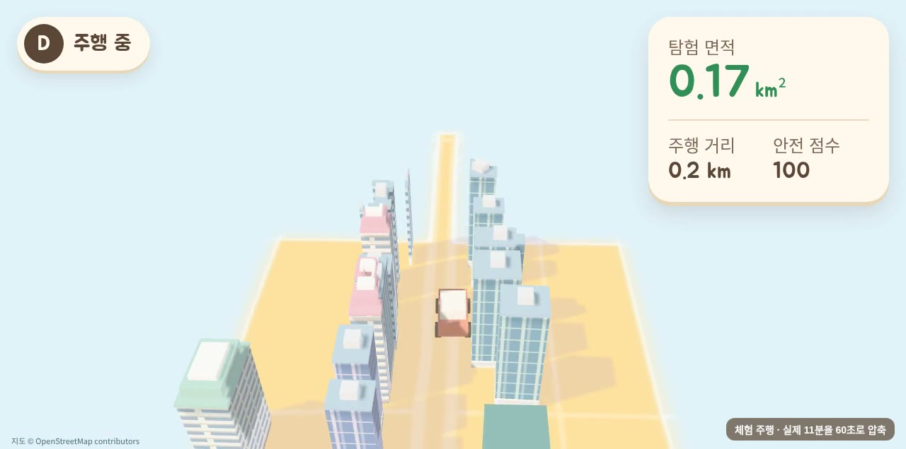
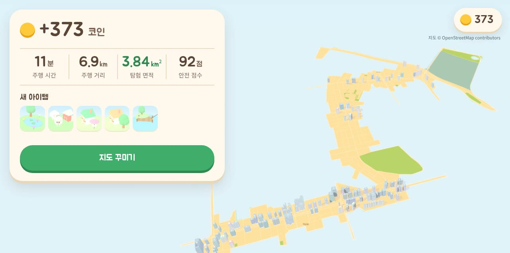
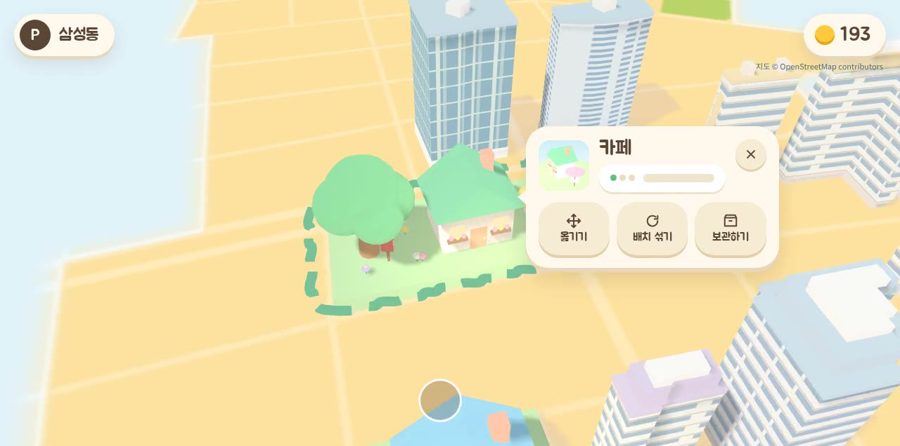

# 카토피아 (Cartopia)

**달린 만큼 열리는 지도 위에 나만의 마을을 꾸미는 Pleos Connect 차량용 게임**

출퇴근길을 달리면 지나간 동네가 3D 지도에 열리고, 주차하면 그 땅에 숲과 카페, 양 목장을 배치합니다. 안전하게 달릴수록 코인을 더 받고, 새로운 지형을 발견하면 새 아이템이 열리며, 배치한 아이템은 주행거리만큼 자랍니다.

| 주행 (기어 D) | 주행 요약 (기어 P) | 꾸미기 |
|---|---|---|
|  |  |  |

- **APK:** [`apk/동네한바퀴_카토피아_release.apk`](apk/동네한바퀴_카토피아_release.apk)
- **시연 영상(1분 55초):** [Releases](https://github.com/lukakas0213/cartopia/releases/latest)
- **게임 규칙:** [docs/game-rules.md](docs/game-rules.md)
- **구조:** [docs/architecture.md](docs/architecture.md)

## 주요 기능

### 기어에 따라 바뀌는 하나의 지도
- 별도 화면 없이 하나의 3D 지도가 기어에 따라 바뀝니다. 기어를 D로 바꾸면 차를 따라가고, P로 바꾸면 주행 기록을 저장한 뒤 꾸미기 화면이 됩니다.
- 주행 중에는 꾸미기를 할 수 없고, 탐험 면적과 주행 거리, 안전 점수만 크게 보여 줍니다.
- 내비게이션 앱이 화면을 차지해도 포그라운드 서비스가 주행 기록을 이어 갑니다.

### 달린 길을 따라 열리는 서울
- 서울 전역의 도로망을 구역으로 나눠 앱에 넣었습니다. 네트워크 없이 동작합니다.
- 위치를 도로 중심선에 맞춘 뒤, 따라 달린 구역과 주변 150 m의 작은 구역, 길게 나란히 지나간 공원과 산을 엽니다.
- 오늘 처음 연 구역은 노란빛으로 표시되어, 주행을 마치면 오늘 지나간 길을 지도 전체에서 한눈에 볼 수 있습니다.
- 고층 건물은 실제 평면 모양으로 서 있고, 시연 주행의 출발점인 현대자동차 강남대로 사옥(스케일타워)은 실제 외관을 본떠 만들었습니다.

### 꾸미기
- 아이템 9종(내 집, 숲, 꽃밭, 연못, 양 목장, 사슴 쉼터, 카페, 빵집, 낚시터)은 고른 구역의 모양과 넓이에 맞춰 지어집니다. 울타리는 구역 경계를 따라가고, 나무와 양의 수는 넓이에 비례합니다.
- 옮기기, 배치 섞기, 보관하기, 보관함에서 다시 꺼내기는 무료입니다.

### 게임 규칙
| 규칙 | 내용 |
|---|---|
| 코인 | 1 km당 10코인 × 안전 배율(0.5~1.5배) + 직접 지나간 새 면적 4,000㎡당 1코인 |
| 해금 | 공원을 발견하면 연못과 양 목장, 산림이면 사슴 쉼터, 상업지면 카페와 빵집, 강가면 낚시터가 열립니다. |
| 성장 | 배치한 뒤 30 km를 달리면 2단계, 100 km를 달리면 3단계로 자랍니다. |
| 안전 점수 | 급가속, 급제동, 방향지시등 없는 방향 전환, 안전벨트 미착용을 감점합니다. |
| 부정 방지 | 차량 주행거리와 GPS 거리가 30% 넘게 다르면 코인을 지급하지 않습니다. |

### 운전자를 방해하지 않는 음성 안내
- 내비게이션 안내가 나오는 동안에는 기다리고, 너무 오래 기다리면 안내를 버립니다.
- 탐험 면적이 일정 크기를 넘을 때와 주행이 끝났을 때만 짧게 말합니다.

## 사용한 Pleos Connect SDK

| SDK | 버전 | 용도 |
|---|---|---|
| Vehicle | 2.3.2 | 기어, 브레이크 페달, 방향지시등, 안전벨트 경고, 주행거리 |
| FusedLocation | 1.1.3 | 차량 위치 |
| TextToSpeech | 3.3.1 | 음성 안내 (사용할 수 없으면 Android TTS로 대체) |

## 실행 방법

1. Pleos Connect 에뮬레이터를 실행합니다([설치 가이드](https://document.pleos.ai/docs/connect/guide/getting-started/application-development/setup-connect-sdk-emulator)).
2. 저장소의 `apk/동네한바퀴_카토피아_release.apk`를 설치합니다.
   ```
   adb install -r 동네한바퀴_카토피아_release.apk
   ```
3. 앱을 실행하면 빈 지도가 열립니다. 왼쪽 아래의 **주행 체험하기**를 누르면 현대자동차 강남대로 사옥(스케일타워) → 테헤란로 → 선릉로 → 청담 한강 경로(6.9 km)를 재생하며 구역이 열립니다.
4. 주행이 끝나면 자동으로 저장되고 주행 요약이 나옵니다. **지도 꾸미기**를 누른 뒤 열린 구역을 눌러 아이템을 배치합니다.

차량 신호가 연결된 환경에서는 기어를 D로 바꾸면 실제 위치로 주행 기록이 시작되고, P로 바꾸면 저장 후 꾸미기 화면이 열립니다.

## 빌드

JDK 17과 Android SDK 35가 필요합니다. Pleos SDK는 `settings.gradle.kts`에 등록된 Pleos Maven 저장소에서 받습니다.

```
./gradlew :app:assembleRelease       # app/build/outputs/apk/release/app-release.apk
./gradlew :app:testReleaseUnitTest   # 구역 열기, 도로 보정, 좌표 변환, 코인, 안전 점수 테스트
```

## 프로젝트 구조

```
app/src/main/
├── java/com/cartopia/app/
│   ├── CartopiaApp.kt, MainActivity.kt   진입점
│   ├── core/       AppCore: 기어 감시, 주행 기록, 코인 지급, 지도 페이지와 메시지 교환
│   ├── car/        Pleos SDK 연결: 차량 신호, 위치, 음성 안내, 시연 경로 재생
│   ├── map/        서울 구역 지도, 도로 중심선 보정, 구역 열기
│   ├── drive/      안전 점수, 코인 계산
│   ├── geo/        위경도 ↔ 지도 좌표
│   ├── data/       기기 안 저장소
│   ├── service/    주행 기록 포그라운드 서비스, 부팅 시 시작
│   └── ui/         WebView 화면, JS 브리지
└── assets/
    ├── village/    3D 지도 페이지: index.html, village.css, village.js, three.js
    └── map/        서울 구역 타일(seoul/), 시연 경로(routes.json)
app/src/test/       단위 테스트
apk/                공모전 제출용 release APK
docs/               게임 규칙, 구조, 문구 기준, 스크린샷
tools/              OSM 데이터로 서울 지도를 만드는 Python 스크립트
```

## 테스트 환경

- Pleos Connect 에뮬레이터 (Android 14, 2560×1440)
- 분할 화면(폭 800, 640)에서도 카드가 화면 아래에 붙도록 확인했습니다.

## 라이선스와 데이터 출처

- 지도 데이터 © [OpenStreetMap](https://www.openstreetmap.org/copyright) contributors (ODbL). 시연 경로는 OSRM으로 계산했습니다.
- [three.js](https://threejs.org) r128, OrbitControls (MIT)
- 주아체 (SIL Open Font License 1.1, `app/src/main/assets/village/jua-OFL.txt`)
