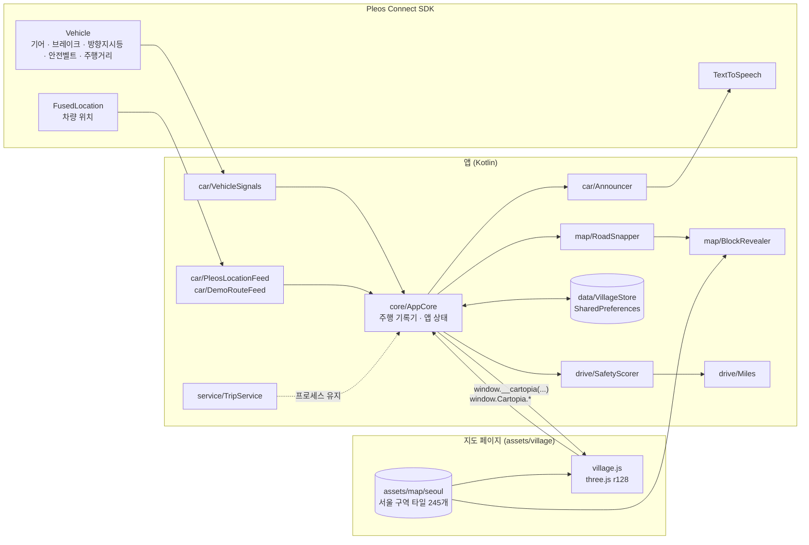

# 구조

카토피아는 Kotlin으로 작성한 앱 본체와, WebView 안에서 three.js로 그리는 3D 지도 페이지로 이루어져 있습니다. 차량 신호와 주행 기록, 코인 계산은 Kotlin이 맡고, 화면에 보이는 모든 UI는 지도 페이지가 그립니다.

## 패키지

| 경로 | 역할 |
|---|---|
| `CartopiaApp`, `MainActivity` | 앱 진입점. `AppCore`는 Activity가 아니라 Application이 하나만 들고 있습니다. |
| `core/` | `AppCore`(기어 감시, 주행 기록, 코인 지급, 페이지 메시지)와 화면 상태(`UiState`). |
| `car/` | Pleos SDK 연결: 차량 신호, 위치, 음성 안내, 시연용 경로 재생(`DemoRouteFeed`). |
| `map/` | 서울 구역 지도(`BlockMap`), 도로 중심선 보정(`RoadSnapper`), 구역 열기(`BlockRevealer`). |
| `drive/` | 안전 점수(`SafetyScorer`)와 코인 계산(`Miles`). |
| `geo/` | 위경도와 지도 좌표 변환(Web Mercator, 줌 16). |
| `data/` | 기기 안에만 저장하는 데이터(`VillageStore`). 주행 경로는 차 밖으로 나가지 않습니다. |
| `service/` | 내비게이션 앱이 화면을 차지해도 주행 기록이 이어지도록 프로세스를 유지하는 포그라운드 서비스와 부팅 수신기. |
| `ui/` | WebView 화면과 JS 브리지(`VillageBridge`). |

## 주행 한 번의 흐름

1. **기어 D:** `AppCore`가 주행을 시작하고 위치 피드를 구독합니다.
2. **위치가 들어올 때마다:**
   - `RoadSnapper`가 위치를 가까운 도로 중심선으로 옮깁니다. 구역은 도로 중심선을 따라 잘려 있는데, 차는 차선 하나 이상 비켜서 달리고 GPS 오차도 있기 때문입니다.
   - `BlockRevealer`가 직전 위치와 지금 위치를 잇는 선분으로 열릴 구역을 계산합니다.
   - `SafetyScorer`는 급가속, 급제동, 방향지시등 없는 방향 전환, 안전벨트 미착용을 감점합니다.
   - 결과는 `reveal`, `car`, `trip` 메시지로 지도 페이지에 전달됩니다.
3. **5초마다:** 진행 중인 주행을 저장합니다. 프로세스가 종료되어도 잃는 기록은 최대 5초입니다.
4. **기어 P:** `Miles`가 코인을 계산해 지급하고, 주행거리를 대기 목록에 넣습니다. 지도 페이지는 요약 카드를 띄우고, 그 거리만큼 배치한 아이템을 키웁니다.

## 구역이 열리는 규칙 (`BlockRevealer`)

| 조건 | 열리는 구역 |
|---|---|
| 도로를 따라 달림 | 구역 경계를 36 px(약 70 m) 이상 따라 달리면 열립니다. 교차로를 가로지르기만 하면 열리지 않습니다. 이 구역만 코인 보너스를 받습니다. |
| 주변 150 m | 2만 ㎡ 이하 구역은 일부라도 150 m 안에 들어오면 열립니다. |
| 큰 구역(공원, 산) | 면적의 절반이 150 m 안에 들어오거나, 경계에서 80 m 안쪽으로 200 m 이상 나란히 달리면 열립니다. |
| 구멍 메우기 | 8천 ㎡ 이하 구역은 둘레의 60%가 열린 구역에 닿으면 열립니다. |
| 중앙분리대 | 분리대(폭 15 m 이하) 건너편 구역도 30 m 안이면 도로를 따라 달린 것으로 봅니다. |

## 지도 데이터

서울 전역을 1024 px 정사각 타일로 나눠 `assets/map/seoul`에 넣었습니다. 네트워크 없이 동작합니다.

- `index.json`: 지도 기준점, 타일 목록과 범위, 서울 경계, 지도 버전
- `big.json`: 타일보다 큰 구역(한강, 산, 공항). 항상 불러옵니다.
- `t/{x}_{y}.json`: 구역 다각형, 지형, 면적, 고층 건물, 바닥 벡터(도로, 공원, 물, 동 이름). 카메라나 차가 다가갈 때 읽습니다.

만드는 방법은 [`tools/README.md`](../tools/README.md)에 있습니다.

## 지도 페이지 (`assets/village`)

| 파일 | 내용 |
|---|---|
| `index.html` | 화면 골격(상단 알약, 서랍, 주행 카드, 저장 화면). |
| `village.css` | 테마 A 스타일. 폭 900 px 이하(분할 화면)에서는 카드가 화면 아래에 붙습니다. |
| `village.js` | 3D 장면, 아이템 모델, 타일 그리기, 게임 규칙, 패널, 카메라. 파일 맨 위에 구역 목차가 있습니다. |
| `three.min.js`, `OrbitControls.js` | three.js r128 (MIT). |
| `jua.woff2` | 주아체 (SIL OFL, `jua-OFL.txt`). |

브리지가 없는 일반 브라우저에서도 페이지가 빈 지도로 열리기 때문에, 디자인 작업은 브라우저에서 바로 할 수 있습니다.
